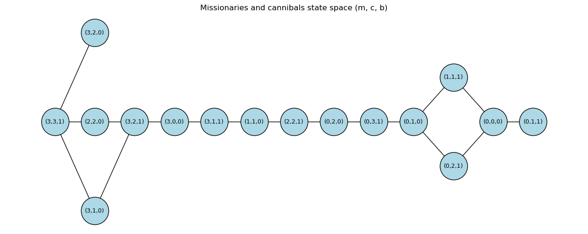

# Tic-Tac-Toe and Missionaries & Cannibals

Two AI search programs.

## Missionaries and Cannibals

`missionaries_cannibals.py` solves the puzzle with breadth-first search. It prints each step of the solution and draws the full state space as `missionaries_cannibals_state_space.png`.



## Tic-Tac-Toe

`tictactoe.py` is a tic-tac-toe agent that uses alpha-beta search. It plays 20 games against itself. Both sides play perfectly, so every game ends in a draw.

## Run it

```bash
pip install -r requirements.txt
python missionaries_cannibals.py
python tictactoe.py
```
